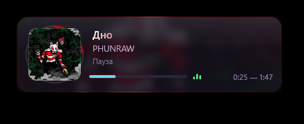
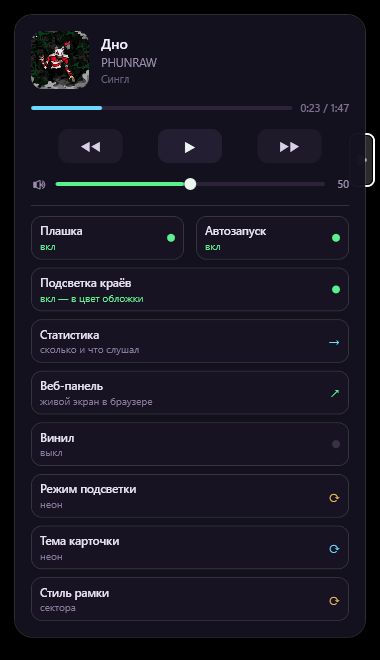

# MediaToast 3.1

Неоновая плашка «сейчас играет» в углу экрана, подсветка краёв под музыку, панель в трее и живая веб-страница. Теперь это одно приложение на **C# / WPF** и один установщик.

Скачать: **[Releases → MediaToast-3.1.2-Setup.exe](https://github.com/Att4cking-812/MediaToast/releases/latest)**

Права администратора не нужны, .NET и PowerShell ставить не нужно — всё внутри установщика.





## Что нового в 3.1

- **Источник звука** — в трее можно выбрать «система» или конкретный плеер (Яндекс Музыка, Spotify, AIMP…). Подсветка будет слушать только его: звуки игры, Discord и браузера не дёргают края.
- Три режима неоновой подсветки: спокойный, агрессивный и универсальный.

## Что нового в 3.0

- **Настоящее приложение на C#**. Больше не набор PowerShell-скриптов и VBS-запускалок: один `MediaToast.exe`, один процесс.
- **Установщик**. Ставится в профиль пользователя (`%LocalAppData%\Programs\MediaToast`), создаёт ярлык в меню «Пуск», по желанию — на рабочем столе и в автозапуске.
- **Перенос данных из v2**: настройки и история прослушивания подхватываются автоматически при первом запуске.
- **Одна панель в трее** управляет всем: плашкой, подсветкой, стилем рамки, темой карточки, винилом, режимом подсветки, веб-панелью и статистикой.
- **Веб-панель и статистика** встроены в приложение: `http://127.0.0.1:8765/` поднимается по кнопке в трее.

## Подсветка краёв

Цвет берётся из обложки текущего трека. Экран подсвечивается по периметру, мягко «дышит» и реагирует на удары баса.

- **Два стиля**: `сектора` (8 сегментов на сторону, на бите выпирают за рамку) и `полосы` (сплошные градиентные ленты, тоньше).
- **Биты по басу**: звук захватывается через WASAPI loopback и фильтруется низом (120 Гц). Голос из Discord почти не пробивается, а кик и бас слышны.
- **Источник звука**: весь системный микс или только выбранный плеер — Яндекс Музыка, Spotify, AIMP и другие. Тогда УЛЬТРАКИЛЛ и голосовой чат вообще не участвуют в подсветке. Если плеер закрыт, подсветка ждёт его и не переключается на игру; на старых сборках Windows 10, где нет захвата по приложению, будет откат на систему (в трее видно «→ система»).
- **Вспышка и двойной удар**: на сильном ударе край вспыхивает вторым оттенком и бьёт ещё раз через ~75 мс.
- **Дыхание** не останавливается: даже в ровном треке подсветка живёт, а биты добавляют акценты.


## Возможности

- **Плашка «сейчас играет»** — обложка, трек, исполнитель, альбом, время, полоска прогресса. Выезжает слева, держится ~5,6 с и уходит.
- **Громкость** — та же карточка в режиме «Громкость» с цветной полосой (зелёный → жёлтый → красный).
- **Пауза** — отдельная карточка «Пауза» с замороженным временем.
- **Обложка** — тянется из системного медиа-API, кешируется, фон карточки — размытая обложка без пикселей.
- **Темы карточки** — `неон`, `минимал`, `стекло`; переключаются в трее.
- **Винил** — круглая вращающаяся обложка во время игры.
- **Копирование трека** — клик по шапке панели кладёт «Исполнитель — Название» в буфер.
- **Статистика** — сегодня / 7 дней / всего, график по дням, топ исполнителей и треков. Данные лежат локально в `%LocalAppData%\MediaToast\listening.tsv`.
- **Веб-панель** — `http://127.0.0.1:8765/`: обложка, управление, громкость, статистика. Запускается из трея, работает локально.
- **Не мешает** — окна без рамки, не забирают фокус, не висят в панели задач и всегда сверху.

Работает с любым плеером, который отдаёт данные Windows: Яндекс Музыка, Spotify, браузеры, AIMP, VLC и т.д.

## Установка

1. Скачай `MediaToast-3.1.2-Setup.exe` из [Releases](https://github.com/Att4cking-812/MediaToast/releases/latest).
2. Запусти. Установщик спросит только автозапуск и (по желанию) ярлык на рабочем столе.
3. Готово — в трее появится иконка, плашка и подсветка включатся сами.

Удаление — через «Приложения и возможности» или ярлык «Удалить MediaToast» в меню «Пуск». Настройки и статистика при удалении не стираются: они лежат отдельно в `%LocalAppData%\MediaToast`.

> Установщик без платной цифровой подписи, поэтому SmartScreen может показать предупреждение. Жми «Подробнее» → «Выполнить всё равно» — это нормально для опенсорсных сборок.

## Управление

- **Клик по иконке в трее** — открыть/закрыть панель.
- **Плашка** — вкл/выкл показ карточки.
- **Автозапуск** — вкл/выкл запуск при входе в Windows.
- **Подсветка краёв** — вкл/выкл.
- **Режим подсветки** — `неон — спокойный`, `неон — агрессивный`, `неон — универсальный`.
- **Тема карточки** — `неон`, `минимал`, `стекло`.
- **Стиль рамки** — `сектора`, `полосы`.
- **Источник звука** — `система` или конкретный плеер (Яндекс Музыка, Spotify и т.д.).
- **Винил** — круглая вращающаяся обложка.
- **Статистика** и **Веб-панель** — открывают локальную страницу `http://127.0.0.1:8765/`.

## Сборка из исходников

Нужен [.NET 9 SDK](https://dotnet.microsoft.com/download) и [Inno Setup 7](https://jrsoftware.org/isdl.php).

```powershell
# из папки src\MediaToast
dotnet publish MediaToast.csproj -c Release -r win-x64 --self-contained true -o publish
iscc installer.iss
```

Готовый установщик появится в `dist\MediaToast-3.1.2-Setup.exe`.

Исходники приложения: [`src/MediaToast`](src/MediaToast).

## Старая версия

PowerShell-версия 2.6 остаётся в корне репозитория — она работает на чистом PowerShell + WPF и не требует сборки. Её описание: [README-v2.md](README-v2.md).

## Лицензия

MIT — см. [LICENSE](LICENSE).
