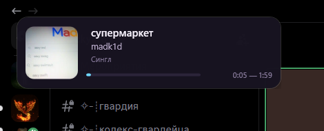
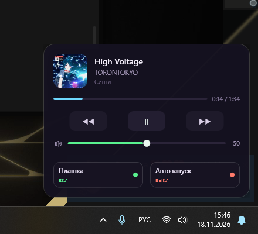

# MediaToast

Всплывающая карточка «сейчас играет» в левом верхнем углу Windows — как медиа-оверлей из Windows 10, но по-своему: обложка, трек, исполнитель, альбом (или «Сингл»), время трека и полоска громкости.



Панель в трее:



## Что умеет

- **Плашка «сейчас играет»** — карточка в левом верхнем углу: обложка, трек, время, громкость.
- **Панель в трее** — клик по иконке открывает управление: обложка, трек, прогресс, ⏮ ⏯ ⏭, громкость и тумблеры «Плашка» / «Автозапуск».
- **Подсветка краёв** — тумблер в панели: экран подсвечивается по периметру цветом обложки. Дышит плавно всегда, а громкие моменты музыки добавляют всплеск яркости. Слушается только аудио-сессия плеера, голосовой чат не влияет.
- **Статистика прослушивания** — кнопка в панели: страница с временем за день/неделю/всего, графиком по дням, топом исполнителей и треков. Данные пишутся локально в `listening.tsv`.
- **Копирование трека** — клик по шапке панели кладёт «Исполнитель — Название» в буфер обмена.
- **Веб-панель** — кнопка в панели открывает живую страницу `http://127.0.0.1:8765/`: большая обложка, управление, громкость и статистика в браузере. Работает локально, сервер поднимается по требованию.
- **Смена трека** — карточка выезжает слева, проявляется и чуть увеличивается; держится ~5,6 с.
- **Громкость** (Fn + клавиши звука или микшер) — та же карточка в режиме «Громкость»: полоска и процент, цвет от зелёного к красному.
- **Пауза** — отдельная карточка с подписью «Пауза» и замороженным временем.
- **Время трека** — `0:41 — 2:39`, полоска прогресса обновляется 4 раза в секунду.
- **Обложка** — тянется из системного медиа-API, кешируется по треку, декодируется в 152 px.
- **Не мешает** — окно без рамки, не забирает фокус, не показывается в панели задач, всегда сверху.

Работает с любым плеером, который отдаёт данные Windows: Яндекс Музыка, Spotify, браузеры, AIMP, VLC и т.д.

## Установка

Нужен Windows 10/11 и PowerShell 5.1 (встроен). Права администратора не нужны.

```powershell
# 1. Запустить один раз — создаст ярлыки в автозагрузке и стартует плашку и трей
powershell -NoProfile -ExecutionPolicy Bypass -File .\install.ps1

# 2. Проверить, что работает
powershell -NoProfile -ExecutionPolicy Bypass -File .\MediaToast.ps1 -Demo -DemoArt .\screenshot.png
```

После установки в трее появится иконка — клик по ней открывает панель управления музыкой.

Остановить: `.\uninstall.ps1` (убирает автозагрузку) или `.\Stop-MediaToast.cmd`.

## Настройка

Все настройки — константы в начале файла и в XAML:

| Что | Где | По умолчанию |
|---|---|---|
| Длительность показа | `$holdMs` в `Show-Toast` | 5600 мс (трек), 2200 мс (громкость/пауза) |
| Позиция | `$area.Left + 24`, `$area.Top + 24` | 24 px от левого верхнего угла |
| Ширина карточки | `Width="384"` в XAML | 384 px |
| Частота опроса медиа | `$mediaTimer.Interval` | 950 мс |
| Частота опроса громкости | `$volumeTimer.Interval` | 260 мс |
| Частота прогресса | `$progressTimer.Interval` | 250 мс |

## Как это работает

- **Медиа** — WinRT `Windows.Media.Control` (SMTC). `IAsyncOperation` ждётся через `AsTask` и рефлексию, потому что PowerShell 5.1 не умеет await напрямую.
- **Громкость** — CoreAudio `IAudioEndpointVolume` через COM-интероп в `AudioEndpoint.cs`.
- **Анимации** — WPF `DoubleAnimation` с `CubicEase`: слайд, масштаб, прозрачность, зум обложки.
- **Процесс** — один экземпляр (мьютекс `Local\BrickyardMediaToast`), PID в `toast.pid`, лог в `toast.log`.

Подробнее о граблях — в [docs/architecture.md](docs/architecture.md).

## Известные ограничения

- Позиция трека в SMTC обновляется только на паузе/перемотке, поэтому время экстраполируется по `LastUpdatedTime` и `PlaybackRate`. Если плеер не отдаёт скорость — считаем 1×.
- Память ~170–200 МБ: это PowerShell + WPF. Для 32 ГБ не проблема, но если нужно 15–20 МБ — нужен компилируемый C#-вариант.

## Лицензия

MIT — см. [LICENSE](LICENSE).
